# Inkwell for KOReader

A KOReader plugin that works as a **client** for a social network for readers: feed, posts,
reviews, highlighted quotes, comments, likes, followers and communities.

  

## Features

Everything runs inside KOReader on the e-reader: no phone, no browser. Every screen is full
screen and made for e-ink (black and white, no animations, big tap targets).

### Post straight from the book

Select a passage while reading and tap **Post to Inkwell** in the highlight menu. The composer
opens with the quote already filled in and the book (title and author) attached. You can add a
title, hashtags and emoji before posting. The same menu has **Use as Inkwell bio**, which turns
the selected passage into your profile bio.

<table>
  <tr>
    <td>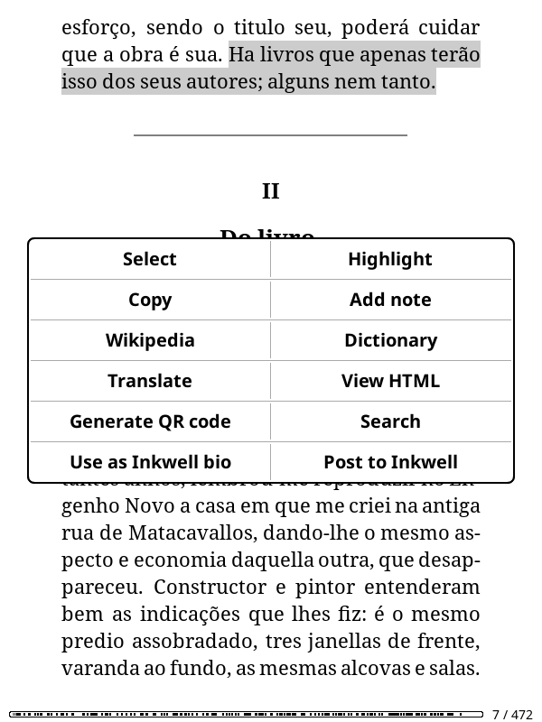</td>
    <td>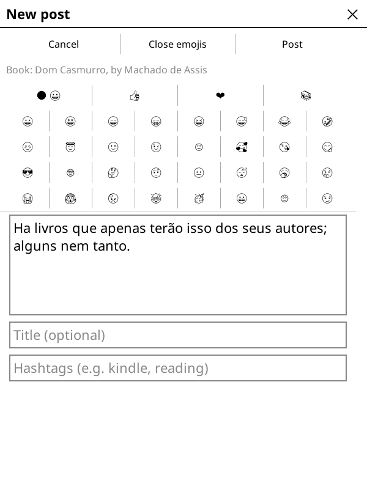</td>
  </tr>
</table>

Emoji work everywhere (posts, comments, buttons): the plugin ships the monochrome Noto Emoji
font, which looks sharp on e-ink and covers what the Kindle's fonts don't.

### Reading activity

Open Inkwell from inside a book (**Tools → Inkwell**, or a gesture bound to the **Open Inkwell**
action) and the plugin syncs the book to your shelf with your progress. When you start a book,
and again when you reach its last page, it asks whether you want to post about it. It never posts
without your OK. Closing the book also saves your progress. You can turn the questions off in
**Menu → Share reading**.

<table>
  <tr>
    <td>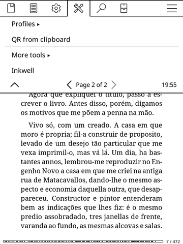</td>
    <td>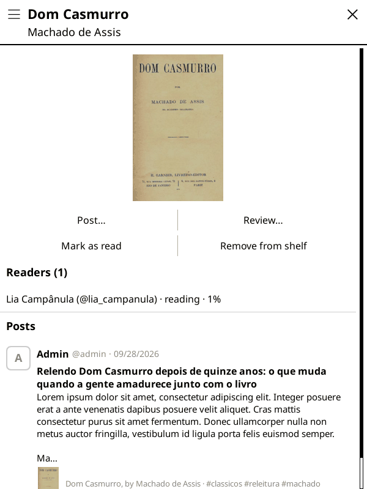</td>
  </tr>
</table>

Each book has its own page: cover, shelf buttons (**Want to read**, **Mark as read**,
**Read again**, **Remove from shelf**), everyone reading it with their progress, and every post
about it. Tap the book on any post to open it.

### Feed

Two tabs: **Following** (only people you follow, in chronological order, no recommendation
algorithm) and **Discover** (everyone). Each card shows the author, date, book, rating, hashtags,
likes and comment count, with pages of 10 posts.

<table>
  <tr>
    <td>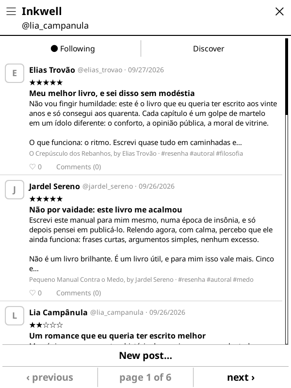</td>
    <td>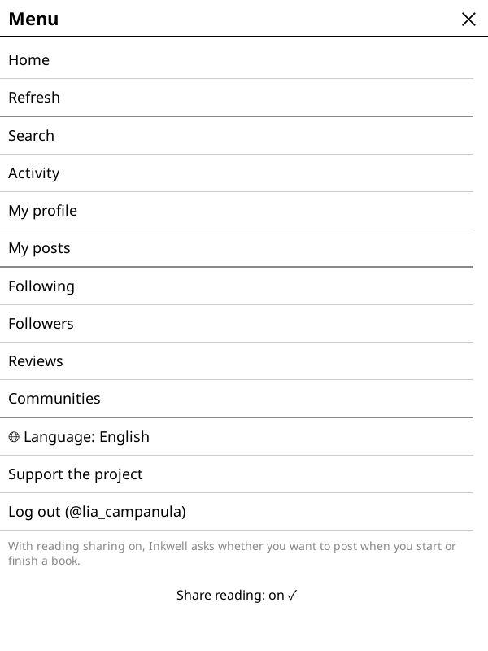</td>
  </tr>
</table>

### Posts, comments and quotes

The post screen shows the full text, likes, comments with threaded replies, and chips that jump
to the author, the book, the community or a hashtag. Like posts and comments, reply to a
comment, or **Quote** a post to share it with your own text. **Delete** shows up wherever the
server allows it: on your own posts and comments, and for moderators and community owners.

<table>
  <tr>
    <td>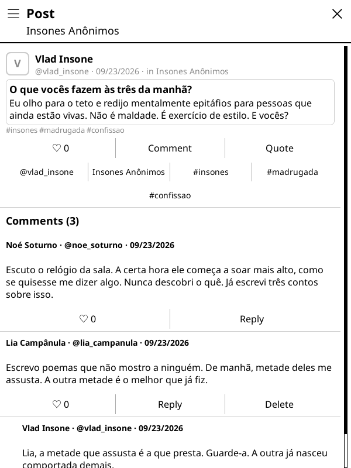</td>
    <td>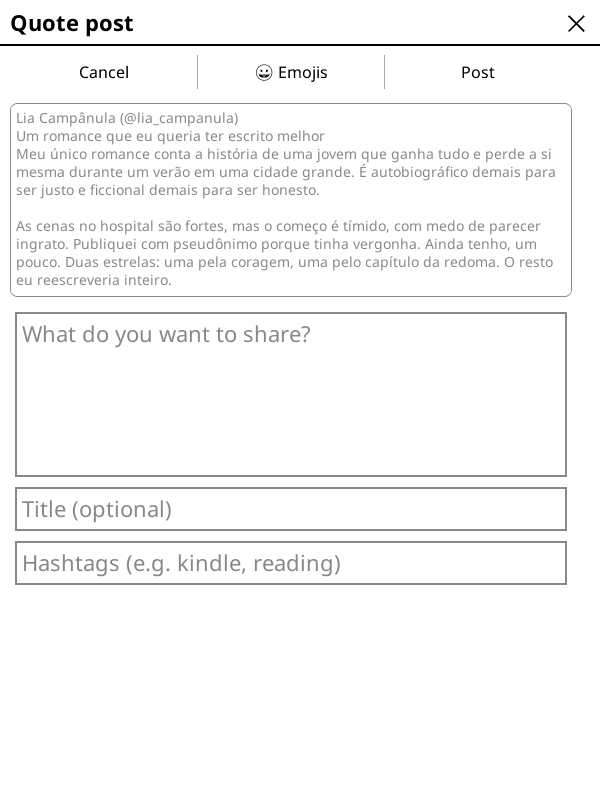</td>
  </tr>
</table>

### Reviews

Rate a book from 0 to 5 stars and write a review, from the book page or from **Menu → Reviews**.
The reviews tab lists the latest reviews from everyone.

<table>
  <tr>
    <td>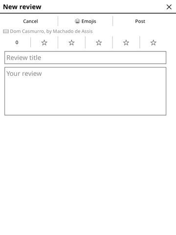</td>
    <td>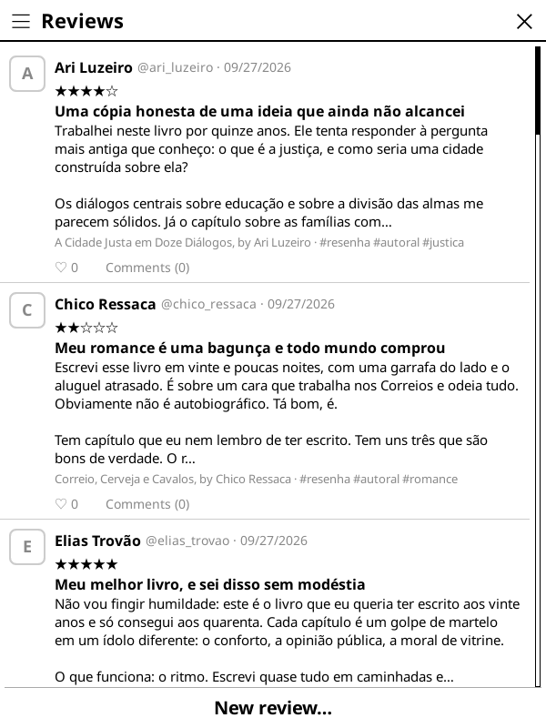</td>
  </tr>
</table>

### Profiles and people

Profiles show the bio, gender, age, post/follower/following counts, the book being read right
now and the shelf. Follow and unfollow from the profile or from the follower lists. Edit your
own profile (name, bio, gender, age, public or private) and choose a profile photo from an
image on the device.

<table>
  <tr>
    <td>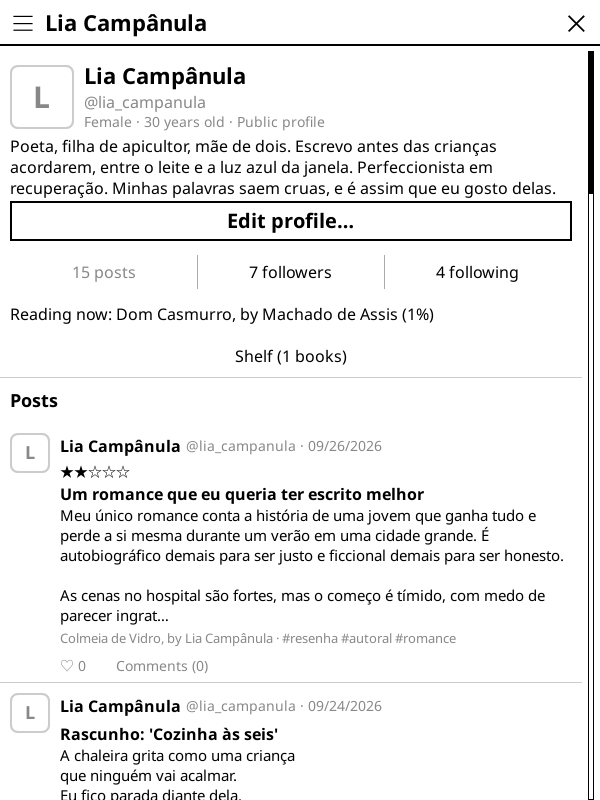</td>
    <td>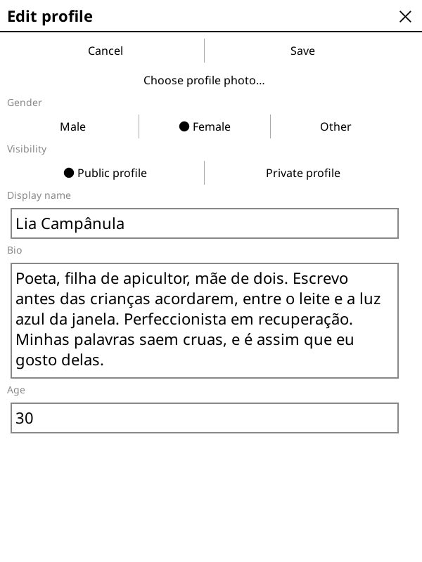</td>
  </tr>
  <tr>
    <td>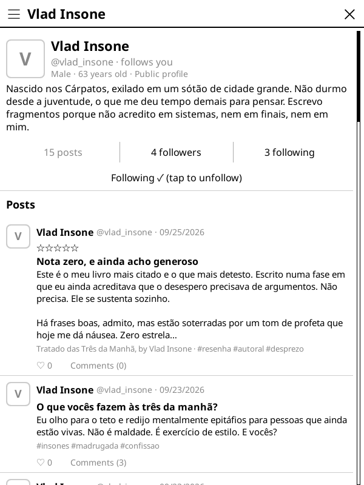</td>
    <td>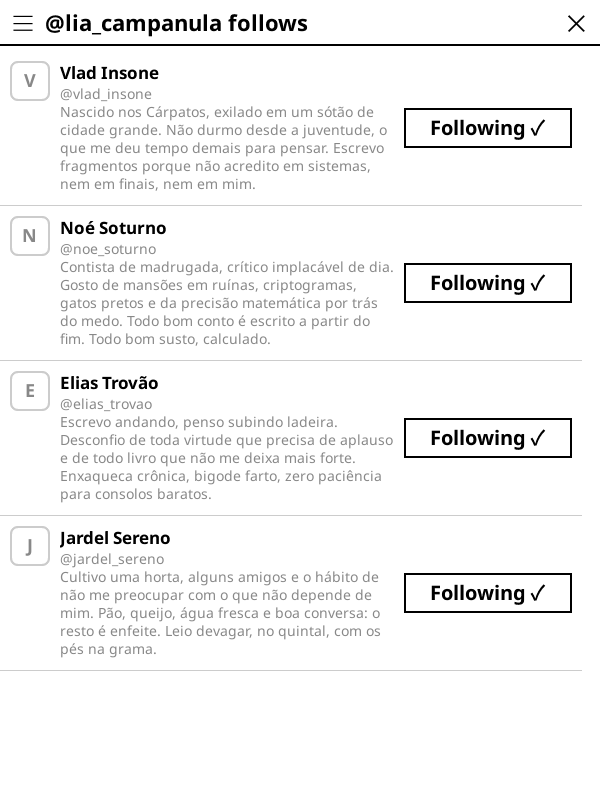</td>
  </tr>
</table>

### Communities

Browse communities in a grid with covers, join or leave them, create your own and post inside
them. Owners can set a cover and make a community private: then only members see the posts, and
new members send a join request that the owner approves or declines.

  

<table>
  <tr>
    <td>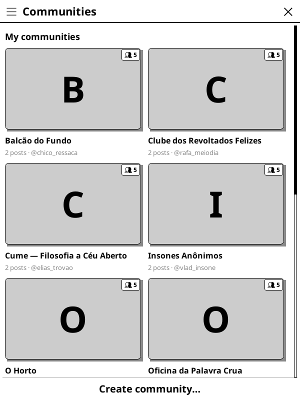</td>
    <td>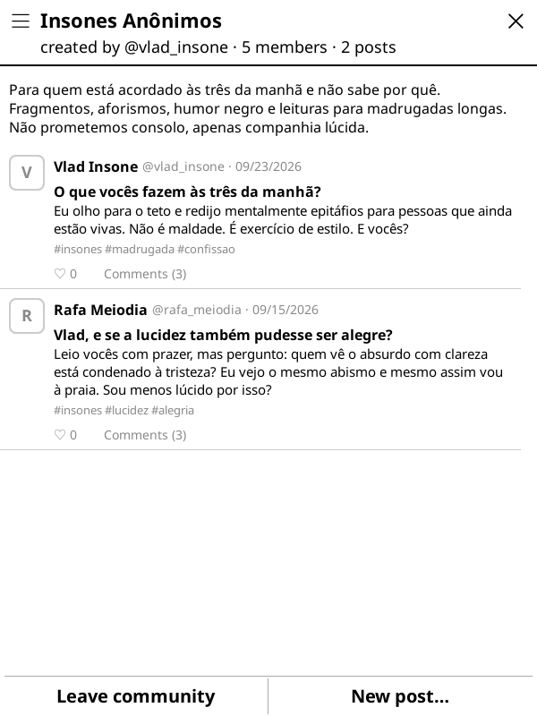</td>
  </tr>
</table>

### Search and hashtags

Search by text or book, by `#hashtag`, or by `@user` to see someone's posts. Tapping a hashtag
chip on a post opens its posts.

<table>
  <tr>
    <td>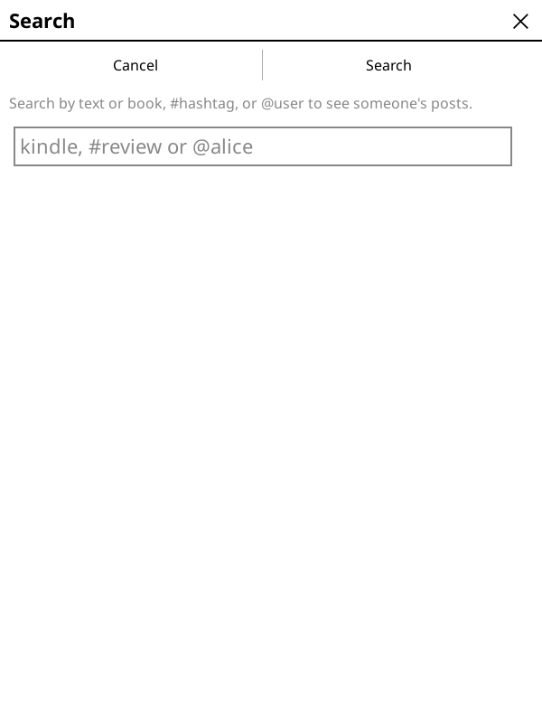</td>
    <td>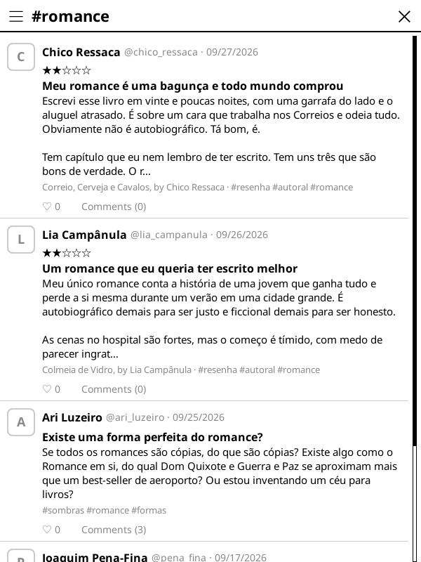</td>
  </tr>
</table>

### Activity

**Menu → Activity** lists likes on posts and comments, comments, replies, mentions, quotes, new
followers, and community join requests and approvals. The feed shows how many are unread.

### Language

The whole UI is available in English and Brazilian Portuguese. Switch from **Menu → Language**;
the current screen reloads in the new language, and the server writes its messages in it too.

  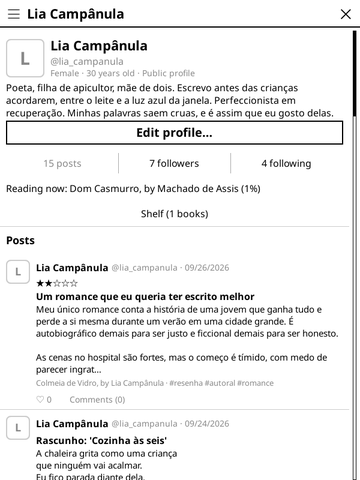

### Account and server

The login screen only asks for email and password, with **Log in** and **Sign up** buttons.
It uses the official server by default. To use another one, tap the small **Server** link in the
bottom-right corner (see [Configuring the API](#configuring-the-api)).
Admins get **Menu → Create moderator**.

<table>
  <tr>
    <td>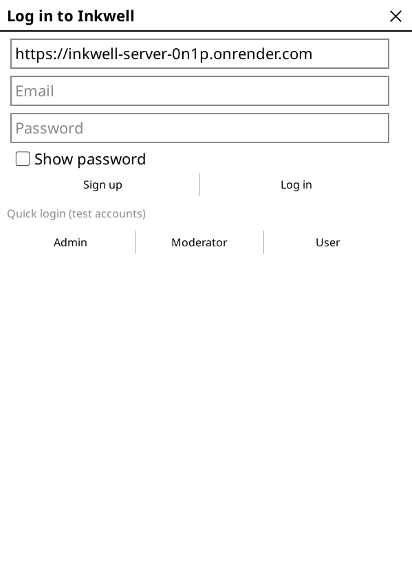</td>
    <td>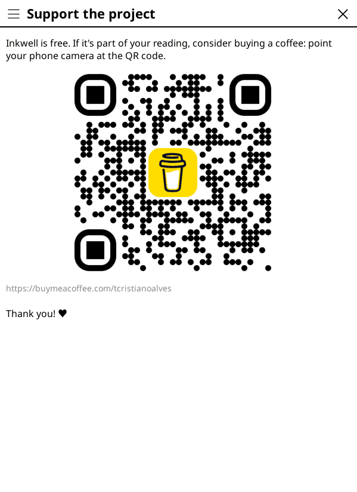</td>
  </tr>
</table>

## It's just a client

The plugin has no built-in server. It points to the official Inkwell server by default,
but the user can switch to any other. All it does is:

- send HTTP/JSON requests to the API you configure;
- display what the API returns;
- display the API's error messages exactly as it sends them.

Any server that implements the contract below works with this plugin.

## Installation

1. Copy the `inkwell.koplugin/` folder to `koreader/plugins/` on the device.
2. Restart KOReader.
3. Open **Inkwell** from the tool menu.

## Support the project

Inkwell is free. If it's part of your reading, consider [buying me a coffee](https://buymeacoffee.com/tcristianoalves).
Inside the plugin, **Menu → Support the project** shows the same link as a QR code.

## Configuring the API

By default the plugin uses the official server, `https://inkwell-server-0n1p.onrender.com`.

To use another API:

1. On the login screen, tap **Server** in the bottom-right corner.
2. A screen opens with the current URL. Type the new base URL, for example
   `https://api.example.com`. Spaces and trailing slashes are removed.
3. Tap **Save** to go back to the login screen. **Cancel** keeps the current server.

The plugin saves this value as `inkwell_server_url` in KOReader's settings and uses that URL
for every request. If you clear the field and save, the plugin goes back to the official server.

The **Server** link is only on the login screen. To switch servers when you're logged in,
log out first (**Menu → Log out**). The session token belongs to the server that issued it,
so switching servers requires a new login.

## API contract

All routes, except `/auth` and image URLs, receive `Authorization: Bearer <token>`.
Request and response bodies are JSON.

### Responses and errors

| Status        | What the client does                                  |
| ------------- | ----------------------------------------------------- |
| `200` / `201` | uses the JSON                                         |
| `204`         | treats it as success with no body                     |
| `401`         | clears the session and asks for login again           |
| `403`         | shows the response's `error` (or "permission denied") |
| anything else | shows `{ "error": "message" }`, if present            |

The plugin shows the `error` text as-is, so the server writes the final user-facing message

### Authentication

| Method | Route            | Body                  | Response                                         |
| ------ | ---------------- | --------------------- | ------------------------------------------------ |
| POST   | `/auth/login`    | `{ email, password }` | `200 { token, username, can_create_moderator? }` |
| POST   | `/auth/register` | `{ email, password }` | `201 { token, username, can_create_moderator? }` |

### UI flags

The client has no permission logic. The server
decides everything and sends the result as flags; the client only shows a button when its flag
is `true`. Hiding a button is cosmetic, so every route must still check authorization on the
server.

| Where              | Flag                   | Button                      |
| ------------------ | ---------------------- | --------------------------- |
| login              | `can_create_moderator` | Menu → Create moderator     |
| `topic` (full)     | `can_delete`           | Delete post                 |
| `topic.comments[]` | `can_delete`           | Delete comment              |
| `community`        | `can_edit_cover`       | Choose/Change cover         |
| `community`        | `can_leave`            | Leave community             |
| `community`        | `can_post`             | New post                    |
| `profile`          | `badge` (text)         | badge next to the @username |

### Routes

| Method             | Route                                               | Purpose                                                      |
| ------------------ | --------------------------------------------------- | ------------------------------------------------------------ |
| GET                | `/topics?offset&limit&feed=following\|reviews\|all` | feed (`{ topics, has_more, total, unread_notifications }`)   |
| GET                | `/topics/search?q=`                                 | search (`@author`, `#tag` or text)                           |
| GET / PUT / DELETE | `/topics/:id`                                       | view, edit, delete post                                      |
| POST               | `/topics`                                           | new post / review / quote / community post                   |
| POST / DELETE      | `/topics/:id/like`                                  | like / unlike                                                |
| POST               | `/topics/:id/comments`                              | comment (`parent_id` replies to a comment)                   |
| DELETE             | `/topics/:id/comments/:cid`                         | delete comment                                               |
| POST / DELETE      | `/comments/:id/like`                                | like / unlike comment                                        |
| GET / POST         | `/communities`                                      | list / create community                                      |
| GET                | `/communities/:id`                                  | community with its posts                                     |
| POST / DELETE      | `/communities/:id/members`                          | join / leave                                                 |
| PUT                | `/communities/:id/cover`                            | cover (`{ data: base64, content_type }`)                     |
| GET / PUT          | `/me/profile`                                       | my profile                                                   |
| PUT                | `/me/avatar`                                        | avatar (`{ data: base64, content_type }` → `{ avatar_url }`) |
| GET                | `/me/posts`                                         | my posts                                                     |
| GET                | `/me/notifications` · POST `/me/notifications/read` | activity                                                     |
| PUT                | `/me/reading`                                       | progress of the open book                                    |
| GET                | `/users/:username`                                  | public profile                                               |
| POST / DELETE      | `/users/:username/follow`                           | follow / unfollow                                            |
| GET                | `/users/:username/followers\|following`             | people lists                                                 |
| GET                | `/books?title=`                                     | book page                                                    |
| POST               | `/admin/users`                                      | create moderator (only called if `can_create_moderator`)     |

Image URLs (`avatar_url`, `cover_url`, `book_cover_url`) must be absolute and public,
because the plugin downloads them without a token.
